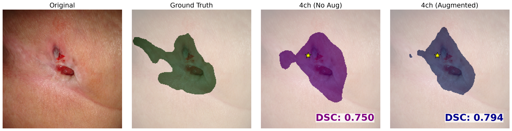

# Interactive Pressure Ulcer Segmentation — Point-Prompted DeepLabV3+

Code and demo for:

> **Interactive Pressure Ulcer Segmentation: A Point-Prompted DeepLabV3+ Approach**
> Wasfieh Nazzal, Karl Thurnhofer-Hemsi, Francisco J. Veredas, Ezequiel López-Rubio.
> *IWINAC 2026*, LNCS 16575, pp. 3–12. https://doi.org/10.1007/978-3-032-27317-8_1

A user's click is encoded as a localised 2-D Gaussian heatmap and concatenated to
the RGB image as a **4th input channel** of a DeepLabV3+ (ResNet-50) network. The
point guides the model toward the wound region and improves segmentation of
ambiguous tissue.

<p align="center"></p>

## Run the demo

```bash
pip install -r requirements.txt
python demo.py
```

That's it — the example image and its mask are included in `example/`, and the
trained weights are in `weights/`. The script prints the two Dice scores and
writes `output.png` with four panels: Original, Ground Truth, 4ch (No Aug),
4ch (Augmented), with the point prompt marked by a star.

### How it works

The point prompt simulates a clinician's single click inside the wound. For a
self-contained, reproducible demo it is sampled from the ground-truth mask
(a random interior point, fixed by a seed), rather than clicked by hand. The
click is encoded as a 2-D Gaussian heatmap (σ = 10) and concatenated to the
grayscale-normalised image as the 4th input channel. Both checkpoints are run
on the same input, and each prediction is scored against the ground-truth mask
with the Dice coefficient.

## Contents

```
demo.py            # the demo
example/           # bundled wound image (example.jpg) + mask (example.npy)
weights/           # trained 4-channel checkpoints (Git LFS)
  ├── model_4ch_noaug.pth    # trained without augmentation
  └── model_4ch_aug.pth      # trained with augmentation
requirements.txt
```

## Citation

```bibtex
@inproceedings{nazzal2026interactive,
  title     = {Interactive Pressure Ulcer Segmentation: A Point-Prompted DeepLabV3+ Approach},
  author    = {Nazzal, Wasfieh and Thurnhofer-Hemsi, Karl and Veredas, Francisco J. and L{\'o}pez-Rubio, Ezequiel},
  booktitle = {International Work-Conference on the Interplay Between Natural and Artificial Computation (IWINAC)},
  series    = {Lecture Notes in Computer Science},
  volume    = {16575},
  pages     = {3--12},
  year      = {2026},
  doi       = {10.1007/978-3-032-27317-8_1}
}
```
